# Glowire devlog

Every major version of the game: what I decided, what got built, and what it looked like.
Each version is a git tag you can play again (see [Play an old version](#play-an-old-version)).

| Version            | Day   | Date        | In one line                                                     |
| ------------------ | ----- | ----------- | --------------------------------------------------------------- |
| `v0.1-first-spark` | Day 1 | Oct 8, 2026 | A real circuit simulator and one 3D board to play with          |
| `v0.2-puzzles`     | Day 1 | Oct 8, 2026 | Puzzles: draw wires, levels 1–10, walls, wire limits, switches  |
| `v0.3-campaign`    | Day 1 | Oct 8, 2026 | A campaign: 4 chapters, 31 levels, coloured LEDs, twist puzzles |
| `v0.4-glowtown`    | Day 1 | Oct 8, 2026 | A game layer: town map, story, stars, shop, pets, daily, bosses |
| `v0.5-open-world`  | Day 2 | Oct 9, 2026 | Landscape pixel-art town you walk around as one hero            |
| `v0.6-route`       | Day 3 | Oct 13, 2026 | One road with lore, dark gates, World 2, the 3D board is back  |
| `v0.7-mossbell`    | Day 4 | Oct 13, 2026 | 8-way walking, changeovers and meters, World 3, the Lantern Lady |
| `v0.8-deep`        | Day 4 | Oct 13, 2026 | Capacitors, World 4 under the sea, a lantern that runs down     |

---

## v0.1 First Spark

**Day 1, morning (Oct 8, 2026, about 12:00–12:45)** · tag `v0.1-first-spark`

### What I decided

- **The pitch:** Glowire is a mobile puzzle game that teaches kids aged 8–12 basic
  electronics. The board is a grid of chunky tiles, shown as a cozy 3D diorama (like
  Townscaper): pastel colours, soft shadows, things that feel tactile, not like a circuit
  diagram.
- **Real physics, not fake rules.** The game runs a real circuit simulator (the maths
  engineers use, modified nodal analysis), with LEDs that behave like real LEDs. So an LED
  with no resistor really does burn out, and a wire across the battery really is a short
  circuit.
- **It has to run on my iPhone** through Expo Go, built from a Windows PC.
- Build the engine first and prove it with tests before any screen exists.

After the first play I said:

> "very cool but currently i cant remove a piece or anything so if i make a mistake it
> doesnt work, also do you think this format of a 2d format will be more fun and easier on
> a phone"

That led to undo/reset and a top-down camera option.

### What got built

- The circuit engine with 11 physics tests (Ohm's law, LEDs, burnouts, shorts, Kirchhoff).
- One 5×5 tutorial board: drag tiles from a tray (straight, corner, T, cross, resistor,
  LED), tap to turn, drag off to remove. Glowing wires and flowing particles show the
  current.

### What it looked like


---

## v0.2 Puzzles

**Day 1, early afternoon (about 13:07–13:23)** · tag `v0.2-puzzles`

### What I decided

> "I don't want it to just be like building circuits. That's pretty boring in of itself."

- **3D top-down** is the camera that works on a phone.
- **Puzzles, not sandbox:** levels with goals, plus limits like "only this much wire".
- **One kind of wire.** Straight, corner, T and cross pieces were confusing ("it's just
  wires"), so now you _draw_ wire by dragging, and junctions form by themselves.
- **Remove anything, any time**, not just the last step.
- **Every few levels, a new part** (resistor, then switch; later ideas: transistor,
  7-segment display), getting harder over time.

### What got built

- Drawn wires, a part tray, walls, wire budgets, switches.
- Levels 1–10 and a level select screen.

### What it looked like


---

## v0.3 Campaign

**Day 1, evening (about 18:45, played around 21:40)** · tag `v0.3-campaign`

### What I decided

> "it should be a game that can be stretched on for YEARS with HUNDREDS of levels
> increasing in difficulty, or it can be a game with like a game concept focusing on
> hardware and wires and there can be different minigames … dont rush, quality over
> quantity"

- I let Claude choose the direction. It picked **one long campaign told in chapters**,
  where each chapter adds one idea, and variety comes from different _kinds_ of puzzle on
  the same board (build, repair, budget, twist) instead of separate minigames. Reasoning
  in [`docs/DESIGN.md`](../DESIGN.md).

### What got built

- Chapter 2 _Colours_: green and blue LEDs, and the physics surprises that come with them
  (blue needs no resistor on 3 V; red "hogs" current from green).
- Chapter 3 _Power Up_: batteries as parts, stacking to 6 V and 9 V.
- Chapter 4 _Twist_: a new puzzle type where everything is on the board, scrambled, and
  you can only turn pieces.
- Saved progress, chapter select. 31 levels in total, each proven solvable by a test.

### What it looked like


---

## v0.4 Glowtown

**Day 1, night, to Day 2 (Oct 8–9, 2026)** · tag `v0.4-glowtown`

### What I decided

After playing v0.3:

> "I wouldn't even say it's like really fun. Like, I feel like I'm just doing it as work …
> maybe if they add some video game elements … shops or animated characters to help you.
> Or you know, like the game … Prodigy. Like it turned math into like some a completely
> different video game … And I also want the puzzles to be more challenging. It's too
> easy."

Choices I made:

- **Game style: restore a dark town.** The town went dark; you're the apprentice
  electrician with a robot sidekick. Every puzzle is a job for a townsperson, and solving
  it lights up their building on the map.
- **Shop: tools and cosmetics**, and "the tools can be pets that do stuff".
- **Difficulty: both.** A short tutorial then a quick ramp, plus star goals and hard bonus
  jobs on top.
- **Keep a version history** (this file), so I can show the game day by day in a video
  series.

### What got built

- **Glowtown map:** four districts down a winding night road. Each job is a building that
  lights up when solved; Pip waits by the next one.
- **Story:** a prologue, district intro and outro scenes, 21 townspeople with portraits,
  and Grumble the villain.
- **Stars and sparks:** every job has 3 stars (solve it, plus two goals like "use 6 wire
  or less" or "no burnouts"). Stars pay sparks.
- **Shop:** pets that help (Scout digs a piece into place, Hoot crosses out parts you
  won't need, Penny earns extra sparks), wire colours, board skins, and hats for Pip.
- **Daily Blackout:** a new generated puzzle every day, with a streak.
- **Bosses:** one per district, in rounds. Grumble sabotages the board between rounds.

### What it looked like


### What I thought

First, on the look:

> "it needs a total ui revamp, it looks SUPER ai coded right now like the font and the
> text boxes"

Then, after seeing it running:

> "No, no, no, no, no. This is not what I wanted the thing to look like … the game should
> actually be played horizontally … the person should be an actual character … moving
> around the city. Talking to people, helping them fix lights … find some resources or
> generate some images yourself rather than just using like shapes and blocks … I need it
> to look professional … each world is like different map or like a different city."

So the v0.4 map is replaced in v0.5. The puzzles, stars, shop, pets and story carry over.

---

## v0.5 Open World

**Day 2 (Oct 9, 2026)** · tag `v0.5-open-world`

### What I decided

- **Play it sideways.** Landscape on the phone, like a real handheld game.
- **A hero you actually walk around** with the keyboard, mouse, or by tapping. You talk to
  townspeople, and they give you jobs. The circuit puzzles open from those jobs.
- **Each world is its own city.** World 1 is Glowtown (chapters 1–2). World 2 is Driftwood
  Harbour (chapters 3–4), marked "coming soon".
- **Real art, not shapes.** Use free CC0 art packs, but mesh them together so they share
  one look.
- **One hero in every world.** Outfits come later.

### What got built

- **Two art packs merged into one style:** Kenney's RPG Urban city tiles and Pixel-boy's
  Ninja Adventure characters. A script (`scripts/art.mjs`) recolours both into one shared
  palette, and a night-lighting shader adds glowing lamps and windows on top.
- **Pixel UI:** dialog boxes and buttons from the Ninja pack, with its pixel font, and
  talking portraits for every character.
- **A pixel-art puzzle board.** The circuit parts are hand-drawn sprites (drawn by a script,
  `scripts/circuit-art.mjs`) so the puzzle matches the town.
- **A map builder** (`src/world`) for laying out new worlds from code.

### What it looked like

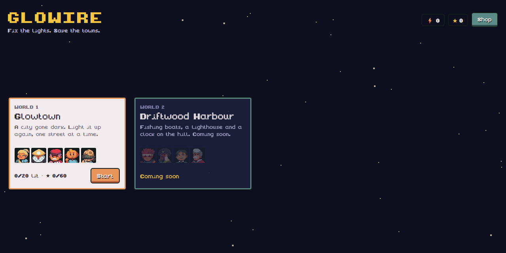
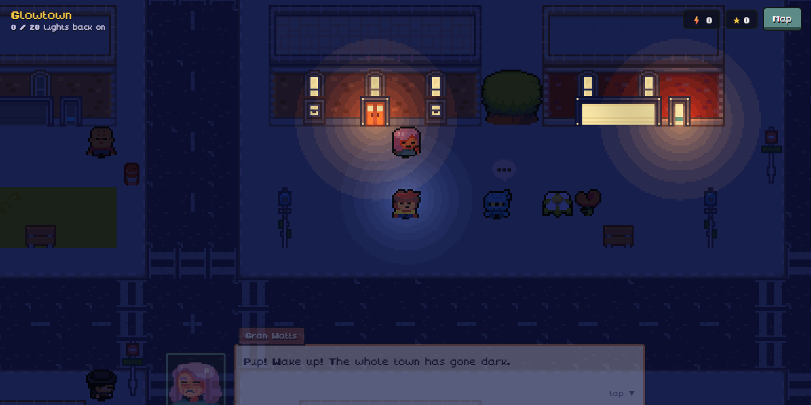

### What I thought

> "the open world works. But it's not that good because it seems like you just walk
> anywhere and there isn't really like a set path … I'd rather have a set path and then
> many different challenges along the way where you meet new people and there's actually
> lore … the map design. It's like a square grid blocks. And everywhere looks the same."

And on the puzzle board:

> "the look of the circuits is very different than what we decided at the start … I think
> it looked better before. So maybe figure out a way to incorporate the theme but keep the
> old look with the 3D floating tiles, that was really cool."

So v0.6 turns the world into a route with a story, and brings the 3D board back.

---

## v0.6 The Route

**Night of Day 3 (Oct 12–13, 2026, overnight)** · tag `v0.6-route`

### What I decided

- **A set path, not a field.** Each world is one road through a row of areas, and each
  area is its own kind of place. You meet new people in order along the way.
- **The road ahead stays dark.** A barrier blocks the way out of each area until every job
  in it is done. Then the darkness lifts off the next stretch.
- **Actual lore.** The road is the Glowire, the wire that carries light to every lamp in
  town. Gran's grandmother Marigold joined it up a hundred years ago. The night she switched
  it on, lightning hit it and left a little cloud behind: Grumble.
- **No more square blocks.** Paths wind, brooks curve, and every area has its own trees,
  ground and buildings.
- **The 3D floating tiles come back**, but themed: the board floats at night in front of
  the street where the job is.

### What got built

- **Glowtown as a route** of eight areas: Gran's Workshop, Maple Lane (gardens and
  cottages), Willow Brook (a stream with one bridge), Schoolhouse Hill (cherry trees), Whisper
  Woods (dead trees, mushrooms, Grumble's nest), Market Square (fountain and stalls), the
  Crossroads (traffic lights) and Clock Plaza (the night bus to the harbour).
- **Driftwood Harbour** (World 2) as a route too: the bus stop, the fish market docks,
  Lighthouse Point, the ferry pier, Warehouse Row, then up Clocktower Hill to the hilltop
  where the Glowire begins.
- **Story scenes** when you walk into each area and when you finish it, **Wren** (a kid
  mapping the Glowire), and **8 pages of Marigold's notebook** to find. Each page is a bit
  of the mystery plus a real electronics fact. The ending: Grumble only wanted it dark
  sometimes, so people would look up at the stars. The town agrees to a Star Night.
- **Travel:** tap the area name to jump back to any area you've reached.
- **The 3D board** at night, with the client and their house beside it. Solve the job and
  their house lights up behind the board.
- **Tools:** a terrain autotiler that reads the art pack's edge tiles, and
  `npm run map-preview` to draw a whole world as one picture.
- **Hero outfits** in the shop: the same kid in five more colours (Ember hoodie, Harbour
  blue, Explorer, Stargazer, Night shift), worn around town.
- **A new part, the diode:** a one-way street for current. Two new harbour jobs teach it:
  Sal's bilge lamp ("One Way") and Bolt the warehouse robot's doors ("Doorbell"), where a
  plain wire lights both lamps and only a diode keeps the side switch to one.

### What it looked like

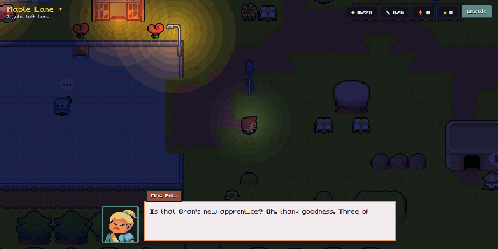
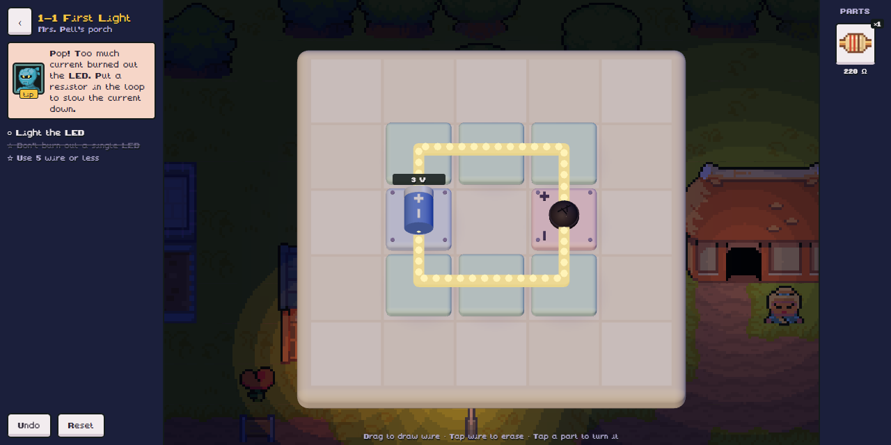
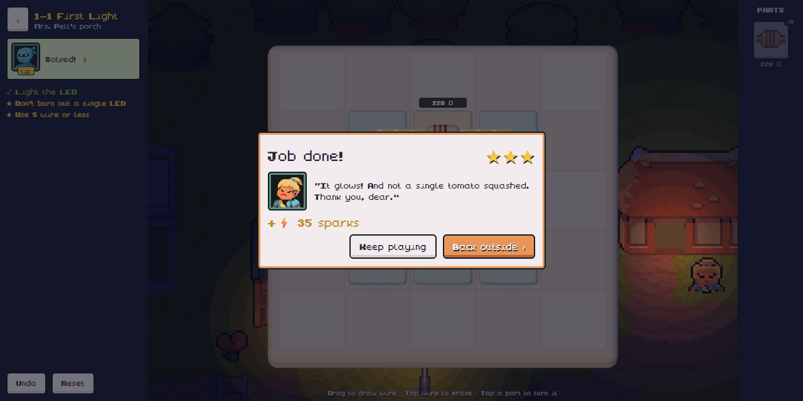

The whole of Glowtown, west to east:

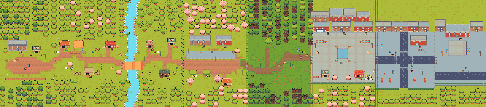

Driftwood Harbour:

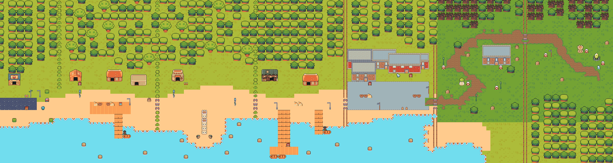

---

## v0.7 Mossbell Hollow

**Day 4 (Oct 13, 2026)** · tag `v0.7-mossbell`

### What I decided

- **Finish the to-do list:** “other mini-games besides circuits, a changeover switch and
  meters, and some art polish (the plain paved squares in the city areas, and a clocktower
  that actually looks like a clock). FINISH UP THIS STUFF”
- **Fix the movement:** “right now it only detects up down left right. it should let me hold
  w and d to go horizontally like right now its not smooth.”
- **A better story:** “the story should be a little more interesting and have MORE
  lore/secrets to find out about certain characters or slightly scary mystery stuff
  happening.”

### What got built

- **Smooth movement in 8 directions.** Hold two keys to walk diagonally. The hero slides
  along walls and is nudged into gaps instead of stopping dead. Tapped walks cut corners, and
  touch screens get a thumb stick.
- **Two new parts.** The **changeover switch** has one lever and two roads for the current,
  and two of them make a staircase light. **Meters** come as an ammeter, which sits in the
  loop and reads milliamps, and a voltmeter, which sits across a part and reads volts. Both
  read live on the board.
- **World 3, Mossbell Hollow:** an old mill village up the valley, empty for fifty years.
  It has five areas: Hollow Stop, Mill Lane, the foggy Mere, the empty houses of Bellfield,
  and the mossy Bell Tower. It holds nine new jobs: chapter 5 “Two Ways” and chapter 6
  “Meters”, plus a three-round boss. You get there on the bus from the harbour hilltop.
- **The mystery.** Every clock on the Glowire stops at 11:52, and a Lantern Lady walks at
  night (she flickers in the distance and vanishes when you get close). The bell rings
  thirteen times. The answer: the lightning left *two* clouds. Glimmer is Grumble’s
  golden twin, and she has kept Marigold’s lantern lit for a hundred years. On the way, you
  find out that Hazel the miller is Wren’s grandma, that Pip’s eye came from the lantern,
  and that Gran met Glimmer as a girl. The ending hints at a light under the sea.
- **Secrets to find:** twinkles mark odd things in all three worlds (a warm coin, a hundred
  scratches, a well that rings). Help people, then talk to them again and choose **Ask
  about…** to hear their secret. Marigold’s notebook now has 10 pages.
- **Journal:** your notebook pages, the secrets you’ve found, and what you know about
  everyone.
- **Mini-games:** **Colour Code** at Ms. Ito’s blackboard, where you read resistor colour
  bands against the clock. **Signal Lamp** at the lighthouse, where you repeat a growing
  pattern of flashes (go far enough and something at sea flashes back). Beating your best
  score pays sparks.
- **Art.** The flat paved squares are now cobblestones with kerbs, drains and puddles, and
  the market has a round fountain. There’s a real clocktower, with a bell and a clock face
  that lights up when it’s fixed, in Glowtown and on Clocktower Hill, and a mossy one in
  Mossbell. All of it is drawn in `scripts/town-art.mjs`.

### What it looked like

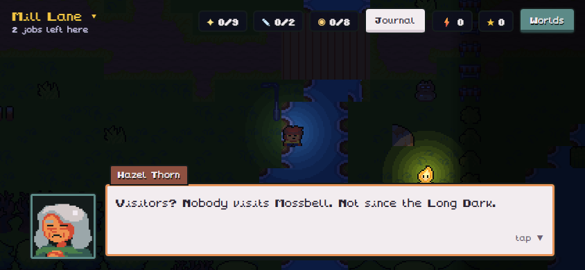
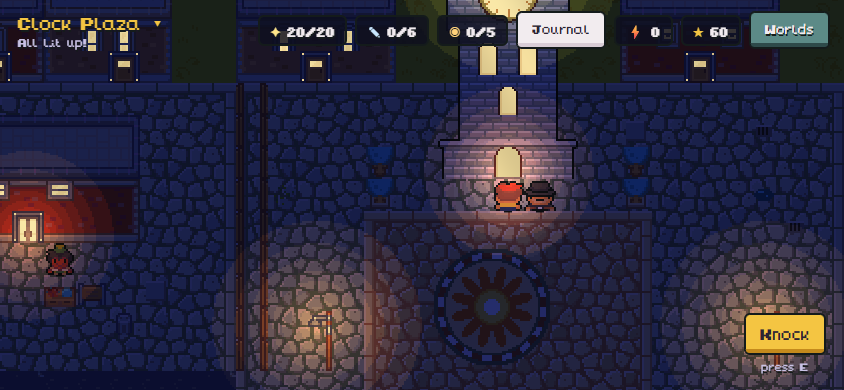
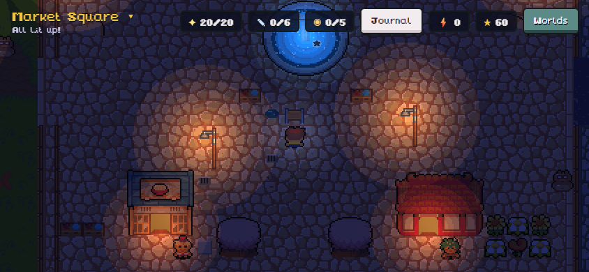
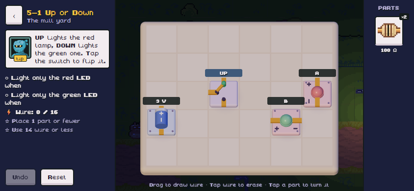
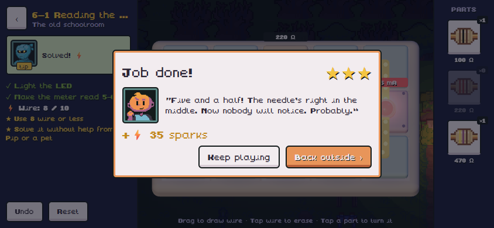
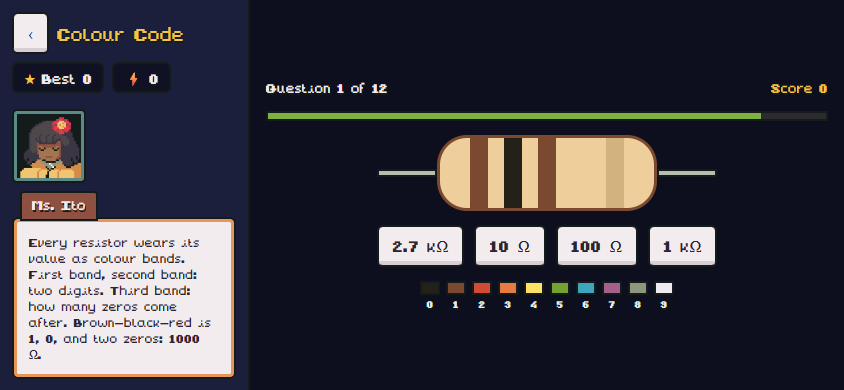
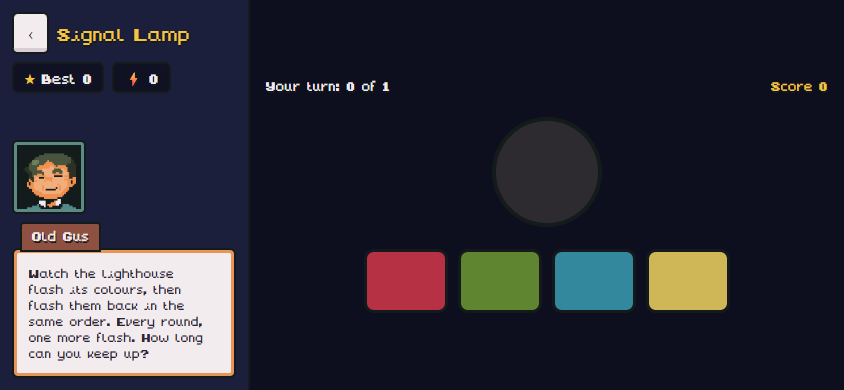
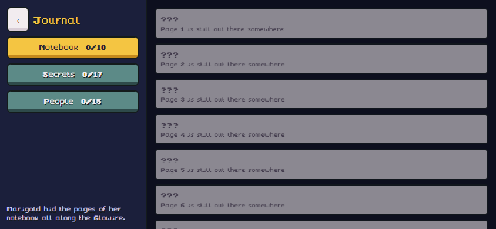

Mossbell Hollow:

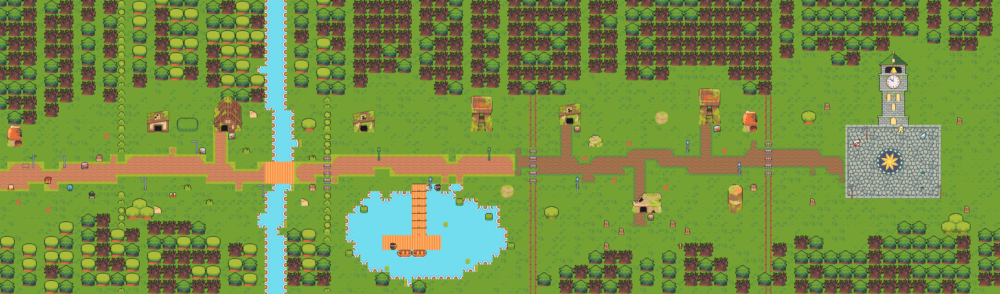

---

## v0.8 Brightwater Deep

**Day 4 (Oct 13, 2026)** · tag `v0.8-deep`

### What I decided

- **Next: World 4 and capacitors together,** with the flashing sea lights and the end of
  the mystery arriving at once.
- **Every world brings a new mechanic:** “yeah each world should introduce a new mechanic.
  and yes work on the rest of it” (the rest being more diode jobs, more twist puzzles, and a
  mini-game in every world).

### What got built

- **A new part: the capacitor**, a “jar” for electricity. It fills while the battery is on
  and empties through the lamp afterwards, so a lamp keeps glowing after you switch it off.
  The solver now steps through time, and the puzzle board runs live: flip the switch and
  watch the lamp fade, while the jar shows its charge. Jobs can now be timed (“keep it
  glowing for 2 to 4 seconds after OFF”, “light it 1 to 3 seconds after ON”), and the goal
  list shows how long it lasts right now.
- **Chapter 7 “Jars of Light”:** seven jobs, among them a slow sunrise lamp, two lamps that
  need diodes to stop their jars sharing, a twist puzzle with jars in it, a camera flash
  worked by a changeover switch, and a three-round boss against **the Hush**.
- **World 4, Brightwater Deep:** a sunken town at the bottom of the sea. Glimmer’s bubble
  takes you down the bottomless well behind Mossbell’s bell tower. There are five areas:
  the Well’s Bottom, Jar Street, the Coral Nursery, the Wreck of the Marigold, and the
  Heart Hall. All of its art is drawn in `scripts/deep-art.mjs`: seabed, kelp reefs, coral,
  jar lamps, air-dome houses, the wreck, a drowned bell, a giant clam and the cracked Heart
  Jar.
- **World 4’s own mechanic: your lantern runs down.** It is darker than any night down
  there. Your light shrinks as your lantern drains, and standing by a lit lamp fills it
  again. When it runs low, eyes open in the dark around you. When it runs out, something
  sends you back to the last light. Bubbles drift up all the while.
- **The mystery, answered.** The Glowire starts at the Heart Jar, which held a hundred years
  of caught storms. The night Marigold switched her town on, lightning cracked it at 11:52
  (which is why every clock stops then). Out came Glimmer and Grumble, and a third cloud
  nobody saw: the Hush, born in the dark, eating light to keep warm. Fill the jar and the
  crack mends, and the twins find they have a little sister. Along the way: Echo, Bolt’s
  brass sister, who has photographed the dark for 99 years; the two bells that answer each
  other (that’s the thirteenth ring); and 16 new secrets and notebook pages 11 and 12. The
  ending points north, to Stormpeak.
- **Mini-games in every world:** **Needle Drop** in Mossbell (pick the resistor that puts a
  meter’s needle on the mark, worked out by the real solver) and **Jar Catch** in the Deep
  (catch falling sparks, pour your jar into the lamp before it overflows, dodge the dark
  drops).
- **More diode jobs, as side jobs** in Driftwood Harbour: **Lamp Test** (a panel with a test
  switch that lights both lamps) and **Turn It Up** (party lights like a stereo’s bars).
  Side jobs don’t hold up the road, so saves already past the harbour aren’t blocked.

### What it looked like

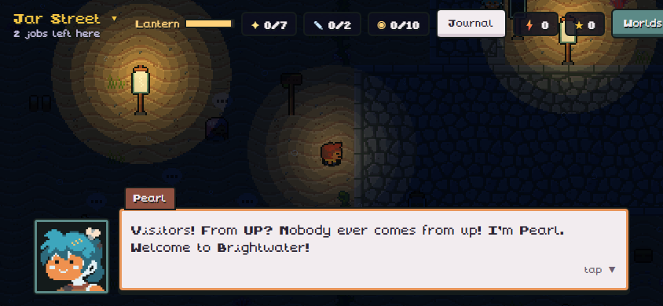
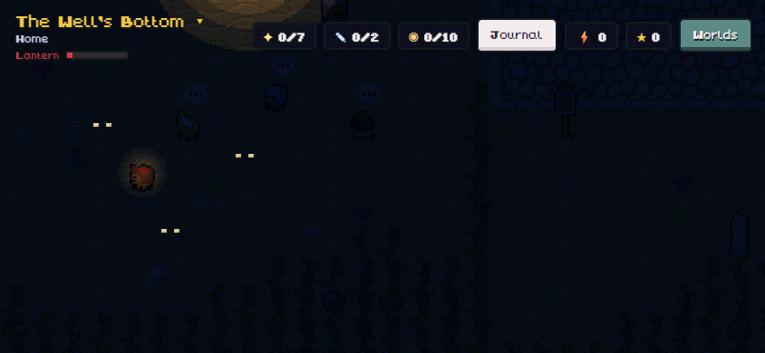
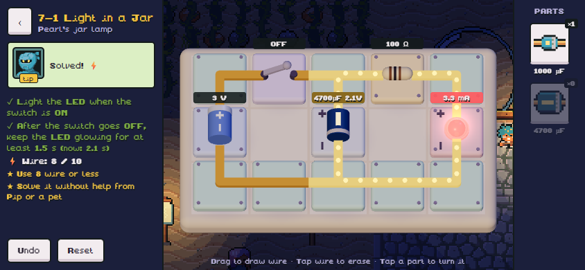
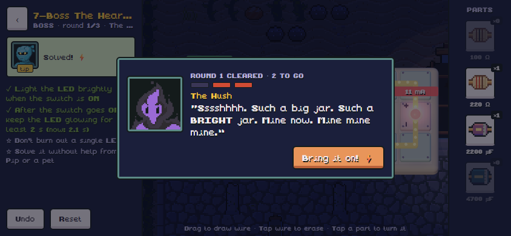
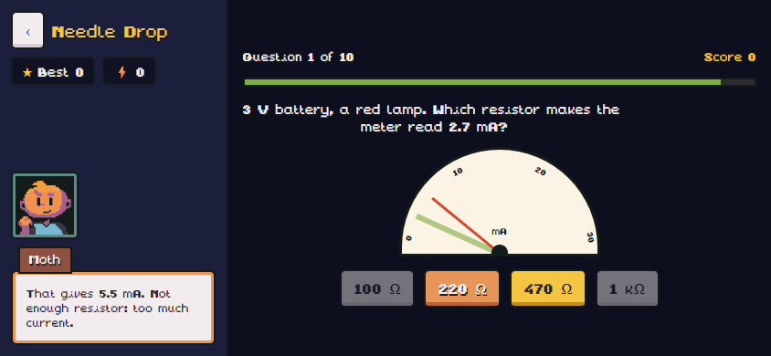
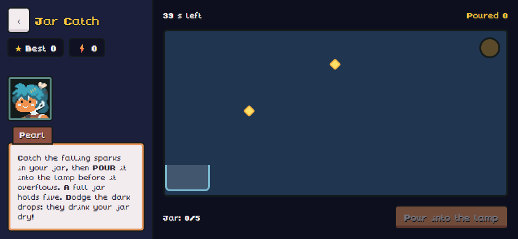

Brightwater Deep (lit):

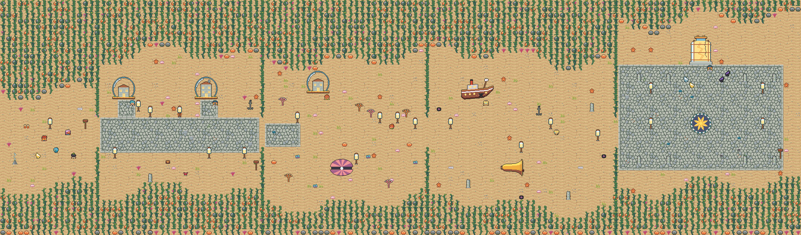

---

## Play an old version

```bash
npm run play-version          # list versions
npm run play-version v0.1     # run that version on port 8090 (press w for web, or scan the QR in Expo Go)
```

It checks the version out into `../Glowire-versions/<tag>`, so your current work is never
touched. The current game can keep running on port 8081 next to it.

In a web browser, v0.1 and v0.2 sometimes show an empty board until the window is resized
(an old web-only bug). On the phone they work normally.

## Adding a version

At every major change: commit, tag it (`git tag -a v0.N-name -m "..."`), add screenshots to
`docs/history/v0.N/`, and add a section here with the decisions in my own words.
