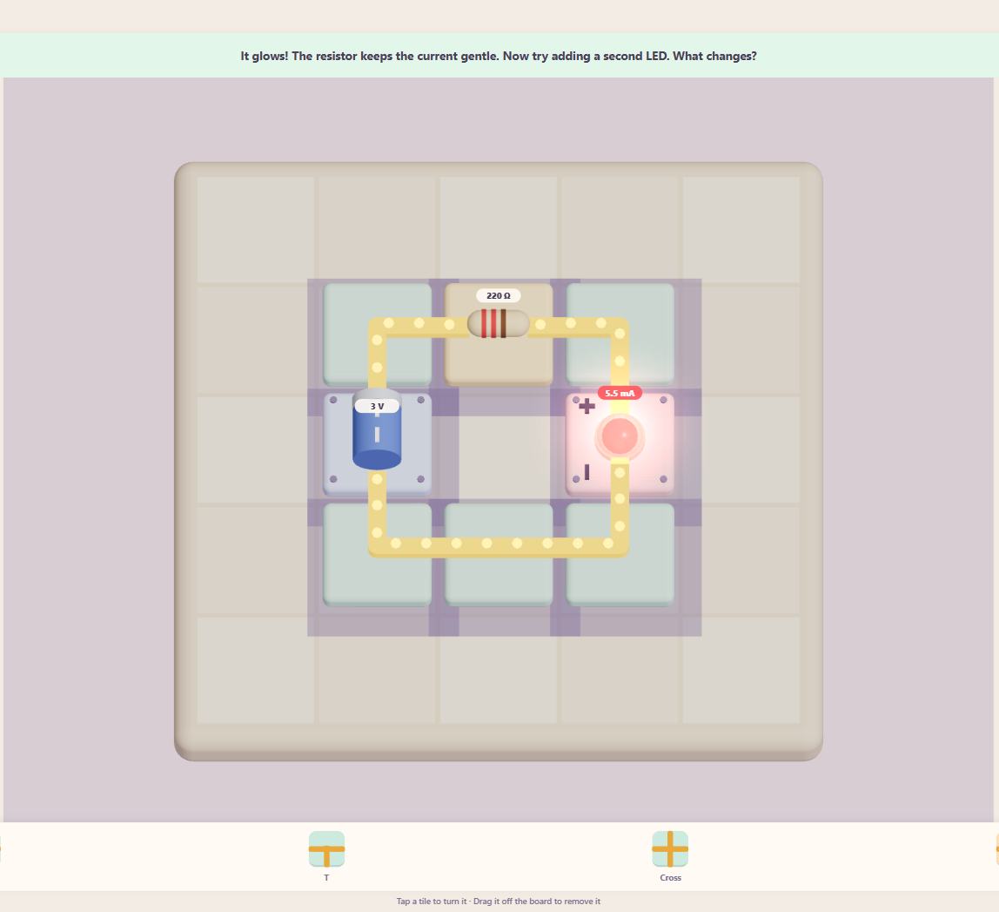
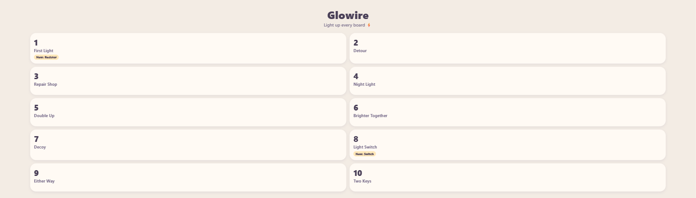
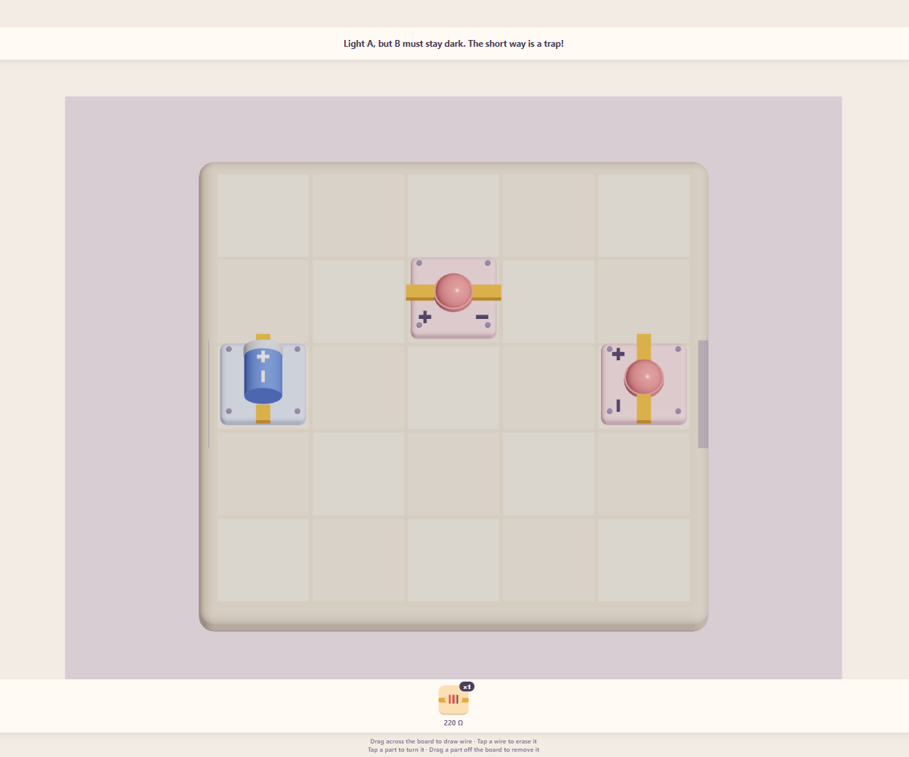
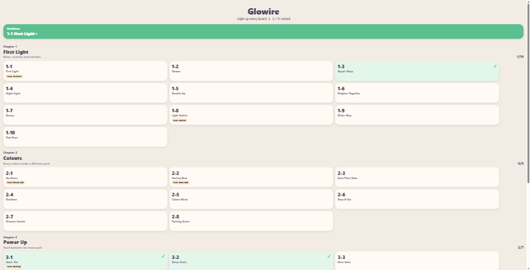
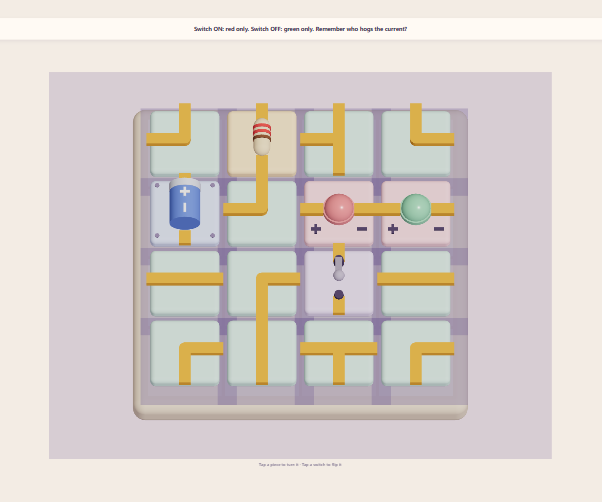
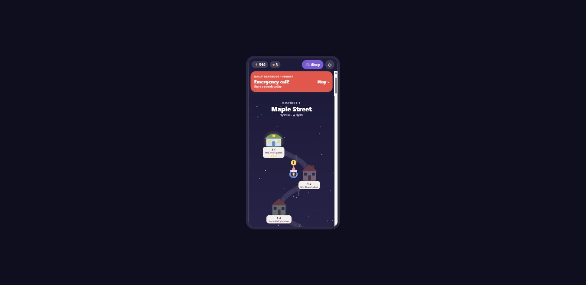

# Glowire devlog

Every major version of the game: what I decided, what got built, and what it looked like.
Each version is a git tag you can play again (see [Play an old version](#play-an-old-version)).

| Version            | Day   | Date        | In one line                                                     |
| ------------------ | ----- | ----------- | --------------------------------------------------------------- |
| `v0.1-first-spark` | Day 1 | Oct 8, 2026 | A real circuit simulator and one 3D board to play with          |
| `v0.2-puzzles`     | Day 1 | Oct 8, 2026 | Puzzles: draw wires, levels 1–10, walls, wire limits, switches  |
| `v0.3-campaign`    | Day 1 | Oct 8, 2026 | A campaign: 4 chapters, 31 levels, coloured LEDs, twist puzzles |
| `v0.4-glowtown`    | Day 1 | Oct 8, 2026 | A game layer: town map, story, stars, shop, pets, daily, bosses |
| `v0.5-open-world`  | Day 2 | Oct 9, 2026 | _In progress:_ walk around pixel-art worlds as one hero         |

---

## v0.1 First Spark

**Day 1, morning (Oct 8, 2026, about 12:00–12:45)** · tag `v0.1-first-spark`

### What I decided

- **The pitch:** Glowire is a mobile puzzle game that teaches kids aged 8–12 basic
  electronics. The board is a grid of chunky tiles, shown as a cozy 3D diorama (like
  Townscaper): pastel colours, soft shadows, things that feel tactile, not like a circuit
  diagram.
- **Real physics, not fake rules.** The game runs a real circuit simulator (the maths
  engineers use, modified nodal analysis), with LEDs that behave like real LEDs. So an LED
  with no resistor really does burn out, and a wire across the battery really is a short
  circuit.
- **It has to run on my iPhone** through Expo Go, built from a Windows PC.
- Build the engine first and prove it with tests before any screen exists.

After the first play I said:

> "very cool but currently i cant remove a piece or anything so if i make a mistake it
> doesnt work, also do you think this format of a 2d format will be more fun and easier on
> a phone"

That led to undo/reset and a top-down camera option.

### What got built

- The circuit engine with 11 physics tests (Ohm's law, LEDs, burnouts, shorts, Kirchhoff).
- One 5×5 tutorial board: drag tiles from a tray (straight, corner, T, cross, resistor,
  LED), tap to turn, drag off to remove. Glowing wires and flowing particles show the
  current.

### What it looked like



---

## v0.2 Puzzles

**Day 1, early afternoon (about 13:07–13:23)** · tag `v0.2-puzzles`

### What I decided

> "I don't want it to just be like building circuits. That's pretty boring in of itself."

- **3D top-down** is the camera that works on a phone.
- **Puzzles, not sandbox:** levels with goals, plus limits like "only this much wire".
- **One kind of wire.** Straight, corner, T and cross pieces were confusing ("it's just
  wires"), so now you _draw_ wire by dragging, and junctions form by themselves.
- **Remove anything, any time**, not just the last step.
- **Every few levels, a new part** (resistor, then switch; later ideas: transistor,
  7-segment display), getting harder over time.

### What got built

- Drawn wires, a part tray, walls, wire budgets, switches.
- Levels 1–10 and a level select screen.

### What it looked like




---

## v0.3 Campaign

**Day 1, evening (about 18:45, played around 21:40)** · tag `v0.3-campaign`

### What I decided

> "it should be a game that can be stretched on for YEARS with HUNDREDS of levels
> increasing in difficulty, or it can be a game with like a game concept focusing on
> hardware and wires and there can be different minigames … dont rush, quality over
> quantity"

- I let Claude choose the direction. It picked **one long campaign told in chapters**,
  where each chapter adds one idea, and variety comes from different _kinds_ of puzzle on
  the same board (build, repair, budget, twist) instead of separate minigames. Reasoning
  in [`docs/DESIGN.md`](../DESIGN.md).

### What got built

- Chapter 2 _Colours_: green and blue LEDs, and the physics surprises that come with them
  (blue needs no resistor on 3 V; red "hogs" current from green).
- Chapter 3 _Power Up_: batteries as parts, stacking to 6 V and 9 V.
- Chapter 4 _Twist_: a new puzzle type where everything is on the board, scrambled, and
  you can only turn pieces.
- Saved progress, chapter select. 31 levels in total, each proven solvable by a test.

### What it looked like




---

## v0.4 Glowtown

**Day 1, night, to Day 2 (Oct 8–9, 2026)** · tag `v0.4-glowtown`

### What I decided

After playing v0.3:

> "I wouldn't even say it's like really fun. Like, I feel like I'm just doing it as work …
> maybe if they add some video game elements … shops or animated characters to help you.
> Or you know, like the game … Prodigy. Like it turned math into like some a completely
> different video game … And I also want the puzzles to be more challenging. It's too
> easy."

Choices I made:

- **Game style: restore a dark town.** The town went dark; you're the apprentice
  electrician with a robot sidekick. Every puzzle is a job for a townsperson, and solving
  it lights up their building on the map.
- **Shop: tools and cosmetics**, and "the tools can be pets that do stuff".
- **Difficulty: both.** A short tutorial then a quick ramp, plus star goals and hard bonus
  jobs on top.
- **Keep a version history** (this file), so I can show the game day by day in a video
  series.

### What got built

- **Glowtown map:** four districts down a winding night road. Each job is a building that
  lights up when solved; Pip waits by the next one.
- **Story:** a prologue, district intro and outro scenes, 21 townspeople with portraits,
  and Grumble the villain.
- **Stars and sparks:** every job has 3 stars (solve it, plus two goals like "use 6 wire
  or less" or "no burnouts"). Stars pay sparks.
- **Shop:** pets that help (Scout digs a piece into place, Hoot crosses out parts you
  won't need, Penny earns extra sparks), wire colours, board skins, and hats for Pip.
- **Daily Blackout:** a new generated puzzle every day, with a streak.
- **Bosses:** one per district, in rounds. Grumble sabotages the board between rounds.

### What it looked like



### What I thought

First, on the look:

> "it needs a total ui revamp, it looks SUPER ai coded right now like the font and the
> text boxes"

Then, after seeing it running:

> "No, no, no, no, no. This is not what I wanted the thing to look like … the game should
> actually be played horizontally … the person should be an actual character … moving
> around the city. Talking to people, helping them fix lights … find some resources or
> generate some images yourself rather than just using like shapes and blocks … I need it
> to look professional … each world is like different map or like a different city."

So the v0.4 map is replaced in v0.5. The puzzles, stars, shop, pets and story carry over.

---

## Play an old version

```bash
npm run play-version          # list versions
npm run play-version v0.1     # run that version on port 8090 (press w for web, or scan the QR in Expo Go)
```

It checks the version out into `../Glowire-versions/<tag>`, so your current work is never
touched. The current game can keep running on port 8081 next to it.

In a web browser, v0.1 and v0.2 sometimes show an empty board until the window is resized
(an old web-only bug). On the phone they work normally.

## Adding a version

At every major change: commit, tag it (`git tag -a v0.N-name -m "..."`), add screenshots to
`docs/history/v0.N/`, and add a section here with the decisions in my own words.
